# Lux Monitor

**The Windows system monitor that blends into your wallpaper.**
Launch it, it shows everything. Click a reading, it opens the right tool.

*[Version française](README.md)*


<p align="center">
  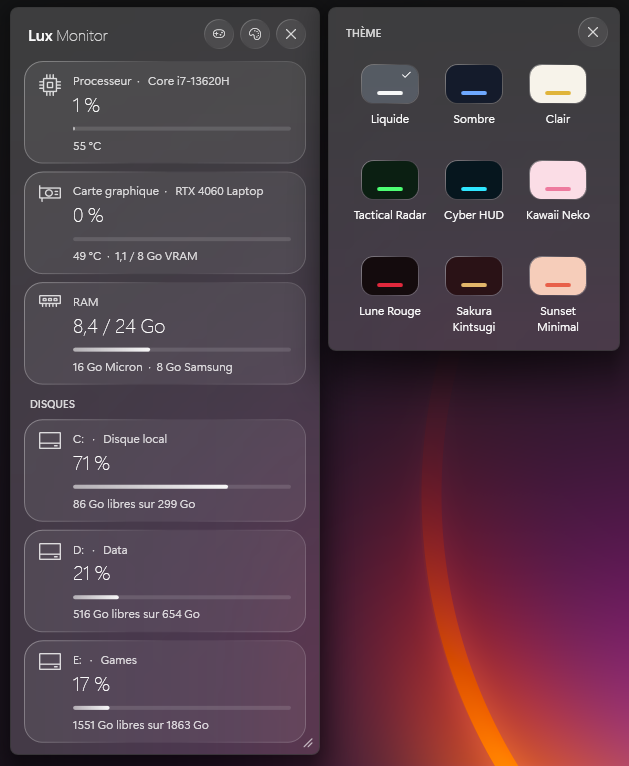
</p>

| Strip | Compact | Game mode |
|:---:|:---:|:---:|
| 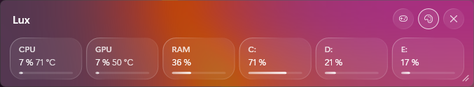 | 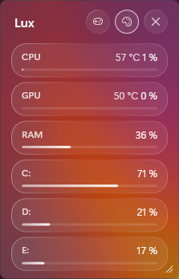 | 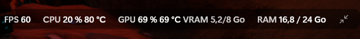 |

*Screenshots show the French interface. Lux Monitor follows your Windows language and can be switched to English at any time.*

---

## Why Lux Monitor?

Existing monitoring tools are powerful, but often tedious to set up: plugins, config files, dozens of sensors to pick from. Lux Monitor takes the opposite approach: **zero configuration**. It shows what matters, beautifully, and every reading **leads somewhere**:

| Click on… | Lux Monitor opens… |
|---|---|
| The processor | Intel Driver & Support Assistant, or AMD Software (otherwise the official driver page) |
| The graphics card | NVIDIA App or AMD Software (otherwise Task Manager) |
| The RAM | Task Manager |
| A drive | That drive in File Explorer |

## Features

- **Processor**: load, model, temperature*
- **Graphics cards**: load, temperature, VRAM. The integrated GPU hides itself when it's idle
- **RAM**: usage and memory modules (manufacturer, size)
- **Drives**: used and free space
- **FPS*** of the foreground application
- **9 themes**, picked from a small window that opens next to the widget (see below)
- **Three layouts**, depending on the width you give it with the bottom-right handle: **compact** (narrow), **normal**, and horizontal **strip** (wide)
- **Game mode**: an always-on-top info bar that clicks pass through, so it never gets in the way. `Ctrl+Shift+L` or the controller button to toggle it
- **English and French**: follows your Windows language, switchable at any time from the tray icon menu, no restart needed
- **Lock window**: no more accidental moving or resizing (tray icon menu)
- **Notification area** icon, start with Windows, remembered position and size

\* *Requires PawnIO and/or administrator rights: see below.*

## Themes

| | | |
|:---:|:---:|:---:|
| 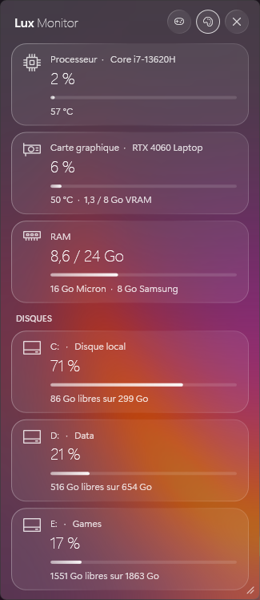<br>**Liquid**: frosted glass that lets your wallpaper show through | 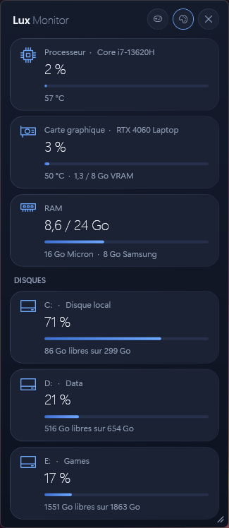<br>**Dark** | 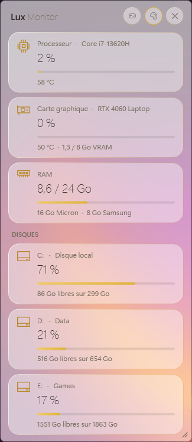<br>**Light**: milky glass |
| 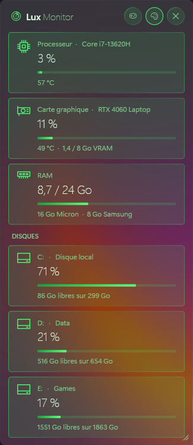<br>**Tactical Radar**: radar green on dark glass | 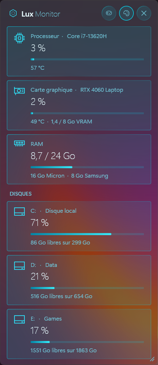<br>**Cyber HUD**: futuristic cyan neon | 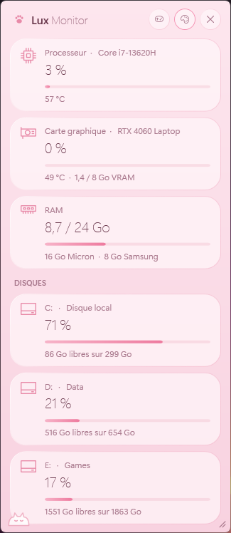<br>**Kawaii Neko**: soft, cute powder pink |
| 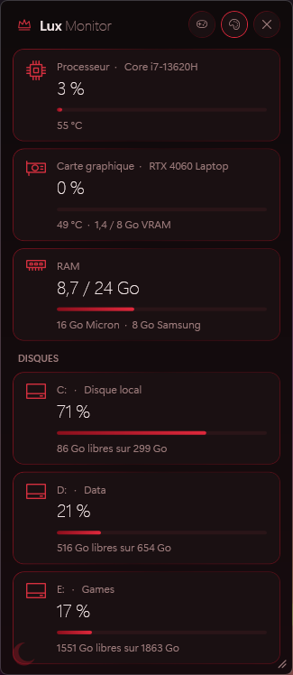<br>**Red Moon**: deep black and blood red | 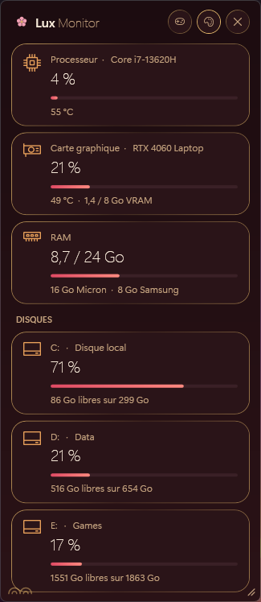<br>**Sakura Kintsugi**: burgundy, gold and cherry blossom | 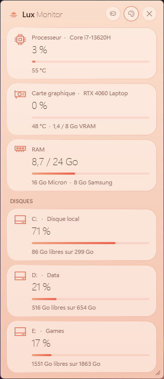<br>**Sunset Minimal**: calm peach and coral |

Each theme has its own colors, corner shapes, and sometimes a subtle touch (a radar, a cherry blossom, a cat paw…). All illustrations are original vector drawings.

## Installation

1. Download **`LuxMonitor.exe`** from the **Assets** section of the [Releases](../../releases) page. *(The "Source code" archives are only for building the project.)*
2. Put it in a permanent location, for example `%LocalAppData%\Programs\LuxMonitor`, and run it. That's it: no installer, no prerequisites (the .NET runtime is included).

> **Windows SmartScreen warning**: the executable is not digitally signed yet, so Windows may show "Windows protected your PC". Click **More info → Run anyway**. You can check that the file is genuine by comparing its SHA-256 hash (`(Get-FileHash .\LuxMonitor.exe).Hash` in PowerShell) with the one published in the release notes. Code signing is planned.

## CPU temperature and FPS

Windows doesn't provide these two readings directly:

- **CPU temperature** requires the [PawnIO](https://pawnio.eu) driver, free and open source, also used by LibreHardwareMonitor and Fan Control.
- **Temperature and FPS** require **administrator rights**.

On first launch, a welcome window explains everything and offers to enable it. Nothing is installed or enabled without your consent. You can change your mind at any time: tray icon menu → **Temperature and FPS…**

If you enable administrator rights, Lux Monitor (after a Windows confirmation prompt):
- copies its exe to **`C:\Program Files\LuxMonitor`**, a folder only administrators can modify;
- creates a **scheduled task** ("Lux Monitor" in Task Scheduler) that runs this copy as administrator every time you sign in, with no confirmation prompt.

Why a copy? So that no malicious program can replace the file that runs as administrator: all the details are in [SECURITY.md](SECURITY.md). After that, double-clicking your exe simply hands over to the scheduled task.

**After an update**, if administrator rights are enabled: "Temperature and FPS…" → **Disable**, then **Enable**, to replace the protected copy with the new version.

> **About PawnIO**
>
> PawnIO is an **independent** project, developed and maintained by its own authors. Lux Monitor is neither affiliated with nor endorsed by PawnIO's authors, and does not distribute or install it: the welcome window only opens its official website, and you decide whether to install it.
>
> A driver has very deep access to the system. Only install PawnIO if you trust its source, and only download it from its [official website](https://pawnio.eu). Its installation, operation and any issues are the responsibility of PawnIO and its authors, not Lux Monitor. For any question about it, please contact [its project](https://github.com/namazso/PawnIO).
>
> Without PawnIO, everything else in Lux Monitor works normally: only the CPU temperature is missing.

**How FPS is measured**: every time a frame is displayed, DirectX reports an event through ETW (*Event Tracing for Windows*), Windows' built-in tracing system. Lux Monitor counts these events, just like Microsoft and Intel's PresentMon. **Nothing is injected into games**: no anti-cheat risk.

## Game mode doesn't show up?

The game is probably in **exclusive fullscreen**: in this mode, the game takes direct control of the display and no window can appear on top. In the game's graphics settings, choose **"Borderless window"**: it looks the same, and the bar shows up.

Tools that still appear over exclusive fullscreen inject themselves into the game. Lux Monitor deliberately doesn't.

## Security

Lux Monitor can run as administrator, so its security went through a **full audit** for v0.2 (7 issues fixed, including a privilege escalation present in v0.1.0). The findings, remaining risks and how to report a vulnerability are in **[SECURITY.md](SECURITY.md)**.

> **Using v0.1.0 with administrator rights enabled?** Update, then "Temperature and FPS…" → Disable, then Enable.

## Known limitations

- **AMD processors**: supported in the code, but not yet tested on real hardware. Feedback welcome!
- **FPS**: some Vulkan or OpenGL games don't emit the DirectX events being measured, so they show no FPS.
- **Intel Arc cards**: seen as integrated GPUs, they are hidden when idle.
- **Exe size (~70 MB) and memory (~200 MB)**: the price of a single file that runs without installing anything, including the .NET runtime and sensor libraries. Optimization is planned.
- **Administrator startup**: a console window may flash for a split second at sign-in (see [SECURITY.md](SECURITY.md)).

## Privacy

Lux Monitor **sends no data** and doesn't use the network. Its settings are stored in `%AppData%\LuxMonitor\settings.json`.

## Uninstall

1. If administrator rights are enabled: "Temperature and FPS…" → **Disable** (removes the scheduled task and `C:\Program Files\LuxMonitor`).
2. Quit Lux Monitor, then delete the exe, the `%AppData%\LuxMonitor` folder and, if present, `%LocalAppData%\LuxMonitor`.

## Building from source

Requirements: Windows 10/11 and the [.NET 10 SDK](https://dotnet.microsoft.com/download) (or Visual Studio 2026 with the ".NET Desktop Development" workload).

```powershell
git clone https://github.com/anotherj4ck/LuxMonitor.git
cd LuxMonitor
dotnet publish LuxMonitor -c Release -o publish
```

The executable is in `publish\LuxMonitor.exe`.

Useful launch options:
- `--demo`: realistic fake readings, to work on the interface without real hardware (in a virtual machine, for example)
- `--diagnostic`: writes `diagnostic-capteurs.txt` to `%LocalAppData%\LuxMonitor` (rights, PawnIO presence, list of all sensors, errors encountered)

### Code structure

```
LuxMonitor/
├── Models/          The data: a "snapshot" of the machine at a given moment
├── Sensors/         Hardware reading (Windows APIs, LibreHardwareMonitor, WMI, ETW)
├── ViewModels/      What the interface displays (WPF, MVVM pattern)
├── Services/        Themes, Windows effects, notification area, admin startup, hotkey...
├── Localization/    French and English texts, and live language switching
├── Themes/          One file per theme (colors, shapes, decorations) and shared styles
└── *.xaml           The windows: widget, theme picker, game mode, welcome
```

Key principles:
- **The interface never reads the hardware itself.** Sensors produce a snapshot of the machine on a separate thread (the interface never freezes), and the interface just displays it. This is what makes `--demo` mode possible, along with several layouts (compact, normal, strip, game mode) for the same data.
- **A theme only contains resources** (colors, corner radii, vector drawings): adding one doesn't require touching the interface code.
- **A language is a dictionary of texts** (`Localization/Strings.cs`): adding one doesn't require touching the windows.

## Contributing

Feedback is welcome, especially on **AMD processors** and **translations**. Open an *issue* for a bug or an idea. For a security vulnerability, please follow [SECURITY.md](SECURITY.md) instead.

## Credits

- [LibreHardwareMonitor](https://github.com/LibreHardwareMonitor/LibreHardwareMonitor) (MPL-2.0): GPU sensors and CPU temperature
- [PawnIO](https://github.com/namazso/PawnIO) (GPL license, with an exception for programs that use it): hardware access driver, installed separately by the user
- [Microsoft.Diagnostics.Tracing.TraceEvent](https://github.com/microsoft/perfview) (MIT): ETW event listening for FPS

## No warranty

Lux Monitor is provided **"as is", without any warranty**, as stated in sections 15 and 16 of the GPL v3.0 license. The author cannot be held liable for any damage resulting from its use, or from the use of the third-party software mentioned here (PawnIO, manufacturer drivers and tools).

## License

Lux Monitor is free software, distributed under the [GNU GPL v3.0](LICENSE) license: you may use, study, modify and redistribute it, provided that modified versions remain free under the same license.

A personal project by [anotherj4ck](https://github.com/anotherj4ck).
