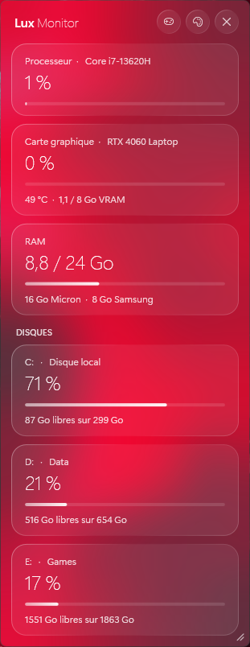
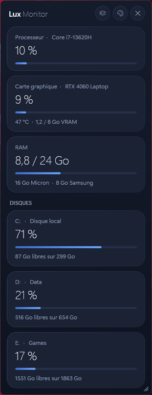
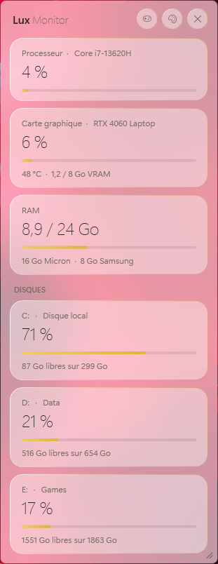
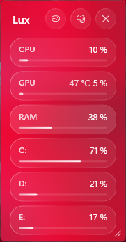
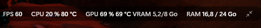

# Lux Monitor

**Le moniteur système pour Windows qui se fond dans votre fond d'écran.**
On le lance, il affiche tout. On clique sur une mesure, il ouvre le bon outil.


| Liquide | Sombre | Clair |
|:---:|:---:|:---:|
|  |  |  |

| Miniature | Mode jeu |
|:---:|:---:|
|  |  |

---

## Pourquoi Lux Monitor ?

Les outils de supervision existants sont puissants, mais souvent pénibles à mettre en place : plugins, fichiers de configuration, dizaines de capteurs à choisir. Lux Monitor fait le pari inverse : **zéro configuration**. Il affiche l'essentiel, joliment, et chaque mesure **mène quelque part** :

| On clique sur… | Lux Monitor ouvre… |
|---|---|
| Le processeur | Intel Driver & Support Assistant, ou AMD Software (sinon la page officielle des pilotes) |
| La carte graphique | NVIDIA App ou AMD Software (sinon le Gestionnaire des tâches) |
| La RAM | Le Gestionnaire des tâches |
| Un disque | Le disque dans l'Explorateur de fichiers |

## Fonctionnalités

- **Processeur** : charge, modèle, température*
- **Cartes graphiques** : charge, température, VRAM. Le GPU intégré se masque tout seul quand il ne sert pas
- **RAM** : utilisation et détail des barrettes (fabricant, capacité)
- **Disques** : espace utilisé et libre
- **FPS*** de l'application au premier plan
- **Trois thèmes** : Liquide (verre flouté qui laisse voir le fond d'écran), Sombre, Clair
- **Redimensionnable** : en dessous d'une certaine largeur, passage automatique en **miniature**
- **Mode jeu** : une barre d'infos toujours au premier plan, traversée par les clics, qui ne gêne jamais le jeu. `Ctrl+Maj+L` ou le bouton manette pour l'activer
- **Zone de notification**, lancement au démarrage, position et taille mémorisées

\* *Nécessite PawnIO et/ou les droits administrateur : voir plus bas.*

## Installation

1. Téléchargez `LuxMonitor.exe` dans la page [Releases](../../releases).
2. Lancez-le. C'est tout : pas d'installation, pas de prérequis (le moteur .NET est inclus).

> **Avertissement Windows SmartScreen** : l'exécutable n'est pas encore signé numériquement, Windows peut donc afficher « Windows a protégé votre ordinateur ». Cliquez sur **Informations complémentaires → Exécuter quand même**. Le code source complet est disponible ici même si vous préférez compiler vous-même. La signature est prévue.

## Température du processeur et FPS

Windows ne fournit pas ces deux informations directement :

- **La température du processeur** nécessite le pilote [PawnIO](https://pawnio.eu), gratuit et open source, utilisé aussi par LibreHardwareMonitor et Fan Control.
- **La température et les FPS** nécessitent les **droits administrateur**.

Au premier lancement, une fenêtre d'accueil explique tout et propose de l'activer. Rien n'est installé ni activé sans votre accord. Si vous acceptez, Lux Monitor crée une **tâche planifiée** (« Lux Monitor » dans le Planificateur de tâches) qui le lance en administrateur à chaque ouverture de session, sans écran de confirmation. Vous pouvez revenir sur ce choix à tout moment : menu de l'icône → **Température et FPS…**

> **À propos de PawnIO**
>
> PawnIO est un projet **indépendant**, développé et maintenu par ses propres auteurs. Lux Monitor n'est ni affilié à PawnIO ni approuvé par ses auteurs, ne le distribue pas et ne l'installe pas : la fenêtre d'accueil ouvre seulement son site officiel, et c'est vous qui décidez de l'installer.
>
> Un pilote a un accès très profond au système. N'installez PawnIO que si vous faites confiance à sa source, et téléchargez-le uniquement depuis son [site officiel](https://pawnio.eu). Son installation, son fonctionnement et ses éventuels problèmes relèvent de PawnIO et de ses auteurs, pas de Lux Monitor. Pour toute question à son sujet, adressez-vous à [son projet](https://github.com/namazso/PawnIO).
>
> Sans PawnIO, tout le reste de Lux Monitor fonctionne normalement : seule la température du processeur est absente.

**Comment les FPS sont mesurés** : à chaque image affichée, DirectX signale un événement dans ETW (*Event Tracing for Windows*), le système de traçage intégré à Windows. Lux Monitor compte ces événements, comme l'outil PresentMon de Microsoft et Intel. **Rien n'est injecté dans les jeux** : aucun risque avec les anti-triche.

## Le mode jeu ne s'affiche pas ?

Le jeu est probablement en **plein écran exclusif** : dans ce mode, le jeu prend le contrôle direct de l'écran et aucune fenêtre ne peut s'afficher par-dessus. Dans les options graphiques du jeu, choisissez **« Fenêtré sans bordure »** (*Borderless*) : le rendu est identique, et la barre s'affiche.

Les outils qui s'affichent malgré tout en plein écran exclusif s'injectent dans le jeu. Lux Monitor ne le fait volontairement pas.

## Limites connues

- **Processeurs AMD** : pris en charge dans le code, mais pas encore testés sur une vraie machine. Vos retours sont bienvenus !
- **FPS** : certains jeux en Vulkan ou OpenGL n'émettent pas les événements DirectX mesurés et n'affichent donc pas de FPS.
- **Cartes Intel Arc** : vues comme un GPU intégré, elles sont masquées quand elles sont au repos.
- **Taille de l'exe (~70 Mo)** : c'est le prix d'un fichier unique qui fonctionne sans rien installer.

## Confidentialité

Lux Monitor **n'envoie aucune donnée** et n'utilise pas le réseau. Ses seuls réglages sont enregistrés dans `%AppData%\LuxMonitor\settings.json`.

## Compiler depuis les sources

Prérequis : Windows 10/11 et le [SDK .NET 10](https://dotnet.microsoft.com/download) (ou Visual Studio 2026 avec la charge « Développement .NET Desktop »).

```powershell
git clone https://github.com/anotherj4ck/LuxMonitor.git
cd LuxMonitor
dotnet publish LuxMonitor -c Release -o publish
```

L'exécutable se trouve dans `publish\LuxMonitor.exe`.

Options de lancement utiles :
- `--demo` : fausses mesures réalistes, pour travailler l'interface sans vrai matériel (dans une machine virtuelle, par exemple)
- `--diagnostic` : écrit `diagnostic-capteurs.txt` à côté de l'exe (droits, présence de PawnIO, liste de tous les capteurs, erreurs rencontrées)

### Organisation du code

```
LuxMonitor/
├── Models/        Les données : une « photo » de la machine à un instant donné
├── Sensors/       La lecture du matériel (API Windows, LibreHardwareMonitor, WMI, ETW)
├── ViewModels/    Ce que l'interface affiche (WPF, modèle MVVM)
├── Services/      Thèmes, effets Windows, zone de notification, démarrage, raccourci clavier...
├── Themes/        Couleurs des thèmes (un fichier par thème) et styles communs
└── *.xaml         Les fenêtres : widget, mode jeu, accueil
```

Principe clé : **l'interface ne lit jamais le matériel elle-même**. Les capteurs produisent une photo de la machine, sur un fil d'exécution séparé (l'interface ne se fige jamais), et l'interface ne fait que l'afficher. C'est ce qui permet le mode `--demo`, et d'avoir plusieurs dispositions (normale, miniature, mode jeu) pour les mêmes données.

## Crédits

- [LibreHardwareMonitor](https://github.com/LibreHardwareMonitor/LibreHardwareMonitor) (MPL-2.0) : lecture des capteurs GPU et de la température CPU
- [PawnIO](https://github.com/namazso/PawnIO) (licence GPL, avec une exception pour les programmes qui l’utilisent) : pilote d'accès au matériel, installé séparément par l'utilisateur
- [Microsoft.Diagnostics.Tracing.TraceEvent](https://github.com/microsoft/perfview) (MIT) : écoute des événements ETW pour les FPS

## Absence de garantie

Lux Monitor est fourni **« tel quel », sans aucune garantie**, comme le prévoient les articles 15 et 16 de la licence GPL v3.0. L'auteur ne peut être tenu responsable des dommages liés à son utilisation, ni à celle des logiciels tiers mentionnés ici (PawnIO, pilotes et outils des fabricants).

## Licence

Lux Monitor est un logiciel libre, distribué sous licence [GNU GPL v3.0](LICENSE) : vous pouvez l'utiliser, l'étudier, le modifier et le redistribuer, à condition que les versions modifiées restent libres sous la même licence.

Projet personnel de [anotherj4ck](https://github.com/anotherj4ck).
